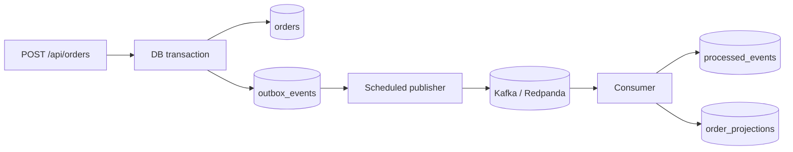

# Kafka + Transactional Outbox | Reliable Event-Driven Orders

**Java 21 · Spring Boot · PostgreSQL · Kafka-compatible Redpanda · JPA · Idempotency**

Demonstrates why a naïve `save(order); kafka.send(event)` is **not atomic**, and how to build a reliable outbox/inbox pattern.

## Architecture



## Run

Requires JDK 21, Maven, Docker.

```bash
docker compose up -d
mvn spring-boot:run
```

```bash
curl -X POST http://localhost:8080/api/orders \
  -H 'Content-Type: application/json' -H 'Idempotency-Key: test-order-001' \
  -d '{"sku":"BOOK-123","quantity":2}'
```

Repeat the identical request; you'll receive the **same `orderId`** and no duplicate outbox event. Wait a moment, then query `GET /api/projections/{orderId}` for the consumer-generated read model.

`mvn verify` runs JPA-backed H2 tests for idempotency without needing Kafka.

## Reliability characteristics

- **Atomicity:** the order and outbox event persist in one PostgreSQL transaction.
- **At-least-once delivery:** the publisher waits for broker acknowledgment before marking the row. A crash between those steps can result in a duplicate event.
- **Consumer idempotency:** persisted event IDs ensure a redelivered event cannot create an additional projection within a successfully committed DB transaction.
- **HTTP idempotency:** a unique request key prevents repeated logical orders. A simultaneous conflicting insert is rejected by a DB uniqueness constraint.

## Production hardening (deliberately not hidden)

- This polling publisher is **single-instance**. Horizontal scaling needs row claiming (`FOR UPDATE SKIP LOCKED`, leases/fencing) or CDC with Debezium. Two live publishers could send duplicates; consumer deduplication reduces impact but does not remove all effects.
- Replace `ddl-auto=update` with versioned migrations and explicit indexes for unpublished rows.
- Add DLQ, poison-message policy, schema registry/versioned events, metrics for outbox lag, partition-key strategy, and broker security.
- The demo `Idempotency-Key` is global; production would scope it by authenticated tenant and endpoint.
- The sample has no authorization, so do not expose it directly on the internet.

_Independent portfolio demonstration. Not affiliated with any employer or customer._
